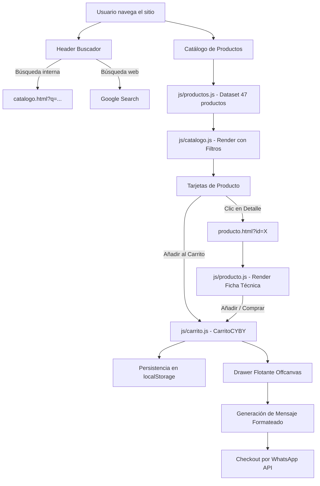

# Documentación Técnica del Proyecto - Bicicletas CYBY

Bienvenido a la documentación técnica y arquitectónica del sitio web oficial y catálogo digital de **Bicicletas CYBY**.

---

## 📁 Estructura del Proyecto

```text
├── css/
│   └── styles.css          # Hoja de estilos global, responsive y componentes UI
├── data/                   # Archivos de datos auxiliares
├── imgs/                   # Imágenes de productos, logotipos y banners
├── js/
│   ├── buscador.js         # Lógica de búsqueda interna y redirección a Google
│   ├── carrito.js          # Sistema integral de carrito y checkout por WhatsApp
│   ├── catalogo.js         # Renderizado dinámico y filtros del catálogo
│   ├── modales.js          # Control de modales legales y de privacidad
│   ├── producto.js         # Vista de detalle de producto individual
│   └── productos.js        # Base de datos local (47 productos estructurados)
├── documentacion/          # Documentación técnica individual por archivo
├── catalogo.html           # Vista del catálogo interactivo completo
├── contacto.html           # Formulario de contacto y ubicación
├── home.html               # Página de inicio alternativa
├── index.html              # Página de inicio principal
├── nosotros.html           # Historia, misión, visión y valores
├── novedades.html          # Lanzamientos, promociones y noticias
└── producto.html           # Detalle dinámico de producto
```

---

## 📑 Índice de Documentación por Archivo

### 🌐 Páginas HTML
1. **[index.html](index_html.md)**: Página de inicio principal de Bicicletas CYBY con hero banner, bienvenida y productos destacados.
2. **[home.html](home_html.md)**: Página secundaria de inicio con la misma estructura y contenido de portada.
3. **[catalogo.html](catalogo_html.md)**: Catálogo interactivo con filtrado por categorías, contador dinámico y buscador integrado.
4. **[novedades.html](novedades_html.md)**: Sección de nuevos lanzamientos, ofertas del mes y blog ciclista.
5. **[nosotros.html](nosotros_html.md)**: Información institucional, misión, visión, valores y fortalezas de la marca.
6. **[contacto.html](contacto_html.md)**: Formulario interactivo de cotizaciones y mensajes, mapa interactivo y datos de contacto.
7. **[producto.html](producto_html.md)**: Vista de detalle dinámico que carga especificaciones completas vía parámetros de URL (`?id=X`).

### 🎨 Hojas de Estilo (CSS)
1. **[styles.css](styles_css.md)**: Estilos globales, variables CSS, maquetación Grid/Flexbox, temas oscuros, animaciones, drawer de carrito y diseño 100% responsivo.

### ⚙️ Scripts JavaScript (JS)
1. **[productos.js](productos_js.md)**: Definición del array global `PRODUCTOS` con 47 elementos y sus metadatos (precios, imágenes, dimensiones, categorías).
2. **[carrito.js](carrito_js.md)**: Clase `CarritoCYBY` para manejo del estado del carrito, `localStorage`, cálculo de totales, botón flotante, drawer lateral y checkout formateado hacia WhatsApp.
3. **[catalogo.js](catalogo_js.md)**: Lógica de renderizado dinámico, filtros por categoría y búsqueda en tiempo real sobre `catalogo.html`.
4. **[producto.js](producto_js.md)**: Extracción del parámetro `id` de la URL, renderizado de ficha técnica y botones de compra directa.
5. **[buscador.js](buscador_js.md)**: Gestión del formulario de búsqueda en el header con soporte para búsqueda interna y en Google.
6. **[modales.js](modales_js.md)**: Manejador de eventos para apertura y cierre (clic, fondo y tecla `Escape`) de los modales de Aviso Legal y Privacidad.

### 🚀 Despliegue y Publicación
1. **[publicacion_github.md](publicacion_github.md)**: Guía paso a paso para hacer público el repositorio en GitHub, desplegarlo gratuitamente con GitHub Pages y actualizarlo.

---

## 🔄 Flujo de Datos y Componentes


